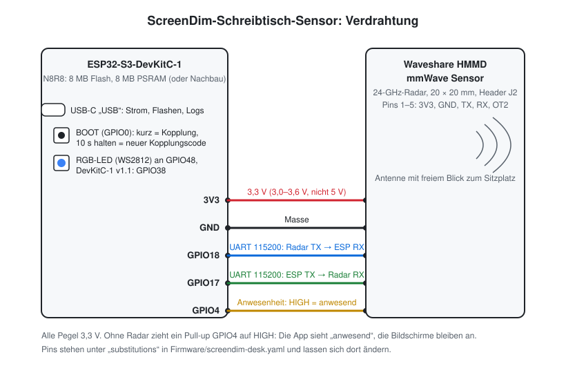
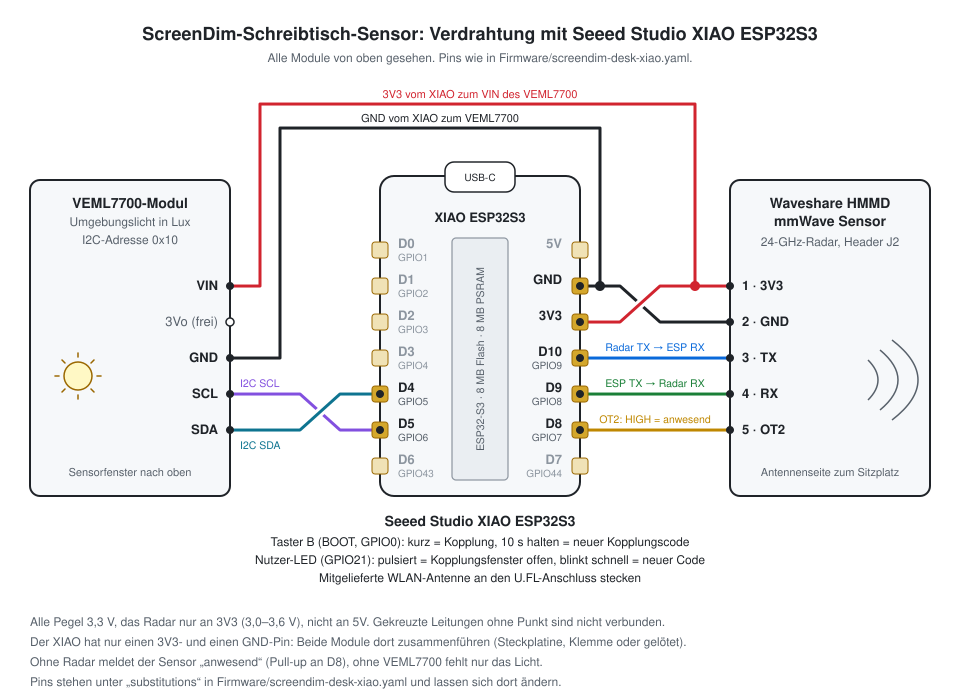

# Schreibtisch-Sensor (ESP32-S3 + Waveshare HMMD mmWave + VEML7700)

ESPHome-Firmware für den optionalen Sensor von ScreenDim. Er meldet Anwesenheit am
Schreibtisch und das Umgebungslicht in Lux; die App dunkelt bei Abwesenheit die
Bildschirme ab, schaltet sie nach einer Weile aus und regelt die Helligkeit nach dem
Licht.

## Stückliste

| Teil | Genau | Hinweis |
|------|-------|---------|
| Mikrocontroller | [ESP32-S3-DevKitC-1](https://www.espressif.com/en/products/devkits/esp32-s3-devkitc-1), Variante N8R8 (8 MB Flash, 8 MB PSRAM) | Nachbauten mit demselben Pinout gehen auch (getestet mit 8 MB Flash, 8 MB PSRAM, natives USB). Die Firmware setzt `flash_size: 8MB`; bei 16 MB den Wert in `screendim-desk.yaml` anpassen. Kleiner geht es mit dem Seeed Studio XIAO ESP32S3, siehe [unten](#variante-seeed-studio-xiao-esp32s3). |
| Radar (Anwesenheit) | [Waveshare HMMD mmWave Sensor](https://www.waveshare.com/hmmd-mmwave-sensor.htm) (24 GHz, 20 × 20 mm) | Erkennt Mikrobewegungen (Atmen, Tippen), nicht nur Gehen. Pinbelegung im [Wiki](https://www.waveshare.com/wiki/HMMD_mmWave_Sensor). |
| Lichtsensor | VEML7700-Modul (Vishay VEML7700 auf Breakout mit Spannungsregler und Pegelwandler, „Vin/logic 3–5 V“, Pins VIN, 3Vo, GND, SCL, SDA) | I2C-Adresse 0x10, Messbereich bis 120 000 lx. Verbreitetes Layout (Adafruit 4162 und Nachbauten); ein Modul ohne Regler (nur 3,3 V) geht genauso. |
| Verbindung | 9 Dupont-Kabel Buchse–Buchse, 10 cm | Oder direkt löten; beide Module kommen mit Stiftleiste. |
| Strom | USB-C-Kabel an den Port „USB“ des Boards | Zum Flashen am Mac, danach an jedem USB-Netzteil. |

Beide Module sind optional: Ohne Radar meldet der Sensor „anwesend“, ohne VEML7700
fehlt nur das Licht (ESPHome markiert den Sensor beim Start als ausgefallen, der Rest
läuft).

## Schaltplan



| HMMD (J2) | ESP32-S3 | Zweck |
|-----------|----------|-------|
| 1 · 3V3 | 3V3 | Versorgung (3,0–3,6 V, **nicht 5 V**) |
| 2 · GND | GND | Masse |
| 3 · TX | GPIO18 (RX) | UART 115200, vorerst nur mitgelesen |
| 4 · RX | GPIO17 (TX) | UART, für spätere Einstellungen |
| 5 · OT2 | GPIO4 | Anwesenheit: HIGH = anwesend |

| VEML7700 | ESP32-S3 | Zweck |
|----------|----------|-------|
| VIN | 3V3 | Versorgung über den Regler des Moduls (3–5 V) |
| GND | GND | Masse |
| SCL | GPIO9 | I2C-Takt |
| SDA | GPIO8 | I2C-Daten, Adresse 0x10 |
| 3Vo | – | Ausgang des Reglers, bleibt frei |

Das DevKitC-1 hat zwei 3V3-Pins und mehrere GND-Pins, es reicht also für beide Module
ohne Steckplatine. Die Pull-up-Widerstände für I2C sitzen auf dem Modul.

Die Pins stehen oben in `screendim-desk.yaml` unter `substitutions`. Ohne angeschlossenes
Radar zieht ein Pull-up GPIO4 auf HIGH: Der Sensor meldet „anwesend“, die Bildschirme
bleiben an.

Die RGB-LED sitzt bei den meisten DevKitC-1-Nachbauten an GPIO48, beim DevKitC-1 v1.1 an
GPIO38 (`led_pin`). Der BOOT-Taster (GPIO0) dient der Kopplung, siehe unten.

Aufstellung: Das Radar mit der Antennenseite (ohne Bauteile) zum Sitzplatz, nicht hinter
Metall. Auf dem Schreibtisch neben dem Monitor reicht; ein Gehäuse aus Kunststoff stört
das Radar nicht. Der VEML7700 soll das Licht sehen, das auch auf den Schreibtisch fällt:
Sensorfenster nach oben, nicht direkt auf den Monitor gerichtet und nicht hinter dem
Monitor; ein Gehäuse braucht an dieser Stelle eine Öffnung.

## Variante: Seeed Studio XIAO ESP32S3

Derselbe Sensor auf dem [XIAO ESP32S3](https://wiki.seeedstudio.com/xiao_esp32s3_getting_started/)
(21 × 17,8 mm, 8 MB Flash, 8 MB PSRAM). Die Firmware `screendim-desk-xiao.yaml` bindet
`screendim-desk.yaml` ein und ändert nur Board, Pins und LED; Radar und VEML7700 bleiben
wie oben.

- Die mitgelieferte WLAN-Antenne an den U.FL-Anschluss stecken, ohne sie ist das WLAN
  sehr schwach.
- Die Stiftleisten liegen bei und müssen angelötet werden, oder die Leitungen direkt an
  die Pads löten.
- Der XIAO hat nur einen 3V3- und einen GND-Pin. Beide Module dort zusammenführen: auf
  einer Steckplatine, mit einer Verbindungsklemme oder die zwei Leitungen am Pin
  zusammengelötet.
- Mit dem Sense-Aufsatz (Kamera) keine microSD-Karte stecken: Der Kartenleser hängt an
  D8–D10.



| HMMD (J2) | XIAO ESP32S3 | Zweck |
|-----------|--------------|-------|
| 1 · 3V3 | 3V3 | Versorgung (3,0–3,6 V, **nicht 5V**) |
| 2 · GND | GND | Masse |
| 3 · TX | D10 (GPIO9) | UART 115200, der ESP32 empfängt |
| 4 · RX | D9 (GPIO8) | UART, der ESP32 sendet |
| 5 · OT2 | D8 (GPIO7) | Anwesenheit: HIGH = anwesend |

| VEML7700 | XIAO ESP32S3 | Zweck |
|----------|--------------|-------|
| VIN | 3V3 | Versorgung über den Regler des Moduls |
| GND | GND | Masse |
| SCL | D5 (GPIO6) | I2C-Takt |
| SDA | D4 (GPIO5) | I2C-Daten, Adresse 0x10 |
| 3Vo | – | Ausgang des Reglers, bleibt frei |

Das Radar hängt mit allen fünf Leitungen nebeneinander an der rechten Stiftleiste (GND,
3V3, D10, D9, D8); nur 3V3 und GND liegen am Radar andersherum. D6 und D7, die TX/RX-Pins
des XIAO, bleiben frei: Über D6 gibt der Bootloader beim Start seine Meldungen aus, die
sonst beim Radar ankämen. Das VEML7700 sitzt an den I2C-Pins des XIAO (D4, D5).

Statt der RGB-LED hat der XIAO eine einfarbige Nutzer-LED (GPIO21): Sie pulsiert im
Kopplungsfenster und blinkt schnell bei einem neuen Code. Der Taster „B“ ist BOOT (GPIO0)
und koppelt wie beim DevKitC-1, „R“ startet neu.

```bash
cd Firmware && ESPHOME_DATA_DIR=/tmp/screendim-esphome ~/.venvs/esphome/bin/esphome run screendim-desk-xiao.yaml --device /dev/cu.usbmodem*
```

Findet der Mac keinen Port: „B“ gedrückt halten, USB einstecken, loslassen; danach flashen
und einmal „R“ drücken.

## Bauen und flashen

ESPHome 2026.10 oder neuer. Den Build-Ordner außerhalb von iCloud halten (für den XIAO
überall `screendim-desk-xiao.yaml` statt `screendim-desk.yaml`):

```bash
uv venv --python 3.12 ~/.venvs/esphome && VIRTUAL_ENV=~/.venvs/esphome uv pip install esphome
```

```bash
cd Firmware && ESPHOME_DATA_DIR=/tmp/screendim-esphome ~/.venvs/esphome/bin/esphome run screendim-desk.yaml --device /dev/cu.usbmodem*
```

Nur die Logs über USB:

```bash
cd Firmware && ESPHOME_DATA_DIR=/tmp/screendim-esphome ~/.venvs/esphome/bin/esphome logs screendim-desk.yaml --device /dev/cu.usbmodem*
```

Spätere Updates gehen auch über die Weboberfläche des Sensors (Login `screendim`, Passwort
= Kopplungscode).

## WLAN einrichten

Ohne gespeichertes WLAN öffnet der Sensor den Zugangspunkt `screendim-desk-xxxxxx`. Mit dem
Mac oder iPhone verbinden, im Captive Portal das WLAN wählen. Alternativ über USB mit
Chrome auf <https://web.esphome.io> („Connect“ → „Configure Wi-Fi“, Improv).

## Kopplung

- Beim ersten Start erzeugt der Sensor einen Kopplungscode (8 Zeichen, `ABCD-EFGH`) und
  speichert ihn.
- **BOOT kurz drücken:** Kopplungsfenster für 2 Minuten, die LED pulsiert blau (XIAO:
  einfarbig). In dieser Zeit holt die App den Code ohne Login
  (`GET /text_sensor/Pairing Code`); alles andere (Weboberfläche, OTA, Zustände) bleibt
  hinter dem Login.
- **BOOT 10 s halten:** neuer Code, die LED blinkt rot (XIAO: schnell). Die App meldet
  „Kopplung verloren“; danach öffnet sich das Kopplungsfenster von selbst.
- Außerhalb des Fensters verlangt der Webserver Digest-Login: Nutzer `screendim`, Passwort
  der Code ohne Bindestrich.

## Reichweite der Anwesenheit

Das Radar sieht mit Werkseinstellung mehrere Meter weit. Damit „anwesend“ nur am
Schreibtisch gilt, wertet die Firmware seine Textzeilen aus (UART, alle 100 ms `ON`/`OFF`
und `Range <n>` in Zentimetern): Anwesend ist nur, wer innerhalb von **Max Distance**
sitzt (Standard 120 cm). Gehst du weiter weg, meldet der Sensor nach 5 s
(`presence_off_delay`) „abwesend“, statt erst, wenn du den Raum verlassen hast. Schweigt
der UART, gilt wie früher der Ausgang OT2 allein.

Einstellen in der Weboberfläche des Sensors (`http://screendim-desk-xxxxxx.local`, Login
`screendim`, Passwort der Kopplungscode ohne Bindestrich):

- **Distance** zeigt, wie weit das Radar dich gerade sieht (leer: niemand erkannt).
- **Max Distance** (30–800 cm) bleibt über Neustarts gespeichert. Setz die Grenze etwa
  30–50 cm über den Wert, den „Distance“ zeigt, wenn du normal sitzt und dich anlehnst.
  Bleibt „anwesend“ beim Aufstehen zu lange, verkleinere sie; meldet der Sensor dich im
  Sitzen kurz als abwesend, vergrößere sie.

Sitzt eine zweite Person näher am Radar als du, zählt ihre Entfernung.

Am XIAO geprüft (2026-11-04, Grenze 120 cm): Beim Weggehen blieb das Radar `ON` und maß
314–398 cm, der Sensor meldete 5 s nach dem Überschreiten der Grenze „abwesend“. Zurück
am Schreibtisch kam „anwesend“ bei 73–113 cm. `Range` ist also in Zentimetern.

## Was die App erwartet

Feste Angaben in `ScreenDimKit/Sources/ScreenDimKit/Sensor/SensorEvent.swift`
(`SensorProtocol`):

- mDNS `_screendim._tcp`, TXT `proto=esphome-sse` und `fw=<Version>`
- `GET /events`: SSE mit `state` (`binary_sensor/Presence`, `sensor/Ambient Light`) und
  `ping` alle 10 s
- `GET /binary_sensor/Presence`, `GET /sensor/Ambient Light`,
  `GET /text_sensor/Pairing Code`; `sensor/Distance` und `number/Max Distance` kommen im
  SSE-Strom mit, die App übergeht sie
- Lux kommt bei 3 % Änderung, sonst alle 30 s: Nach 45 s ohne Ereignis gilt der Sensor
  in der App als ausgefallen, und die Lichtregelung stoppt.

## Offen

- UART des HMMD: Er sendet Text, etwa alle 100 ms `ON` bzw. `OFF` und `Range <n>`
  (am Schreibtisch 5–80, beim Weggehen stetig steigend bis über 400; bei Toren von 70 cm
  gäbe es nur 0–15, also Zentimeter). Die Firmware begrenzt damit die Reichweite
  (Abschnitt „Reichweite der Anwesenheit“). Mit Werkseinstellung meldet das Radar eine
  Person in etwa 3,5 m Abstand noch als anwesend. Noch offen: Abfallverzögerung und
  Empfindlichkeit im Radar selbst einstellen. Das Wiki dokumentiert nur das Lesen von
  Parametern (`0x0008`), nicht das Schreiben; vermutlich steht es im PC-Programm
  `HMMD-mmWave-Sensor-Tools.zip` von Waveshare.
- Abwesenheit am XIAO geprüft (2026-11-04): Nach dem Verlassen des Raums meldet das
  Radar nach etwa 40 s `OFF`, OT2 folgt gleichzeitig, „Anwesenheit: nein“ kommt 5 s
  später (`presence_off_delay`). Beim Zurückkommen gehen UART und D8 sofort auf „ja“.
  Eine Abfallzeit von zusammen etwa 45 s; kürzer geht nur über die Einstellungen des
  Radars (UART). Ohne angeschlossenes OT2 meldet D8 wegen des Pull-ups immer
  „anwesend“, auch wenn das Radar sonst läuft.
- VEML7700 über WLAN prüfen: `GET /sensor/Ambient Light` und Heartbeat im SSE-Strom.
  Per USB am XIAO geprüft (2026-11-04): Lux im Log, abgedeckt etwa 2 lx, unter der Lampe
  etwa 270 lx, bei gleichem Wert kommt der Heartbeat.
- XIAO-Variante: Radar an D8–D10 und VEML7700 an D4/D5 laufen (2026-11-04). Offen: LED
  an GPIO21, Kopplung über „B“. Die DevKitC-Variante ist mit VEML7700 noch nicht am
  Gerät geprüft.
