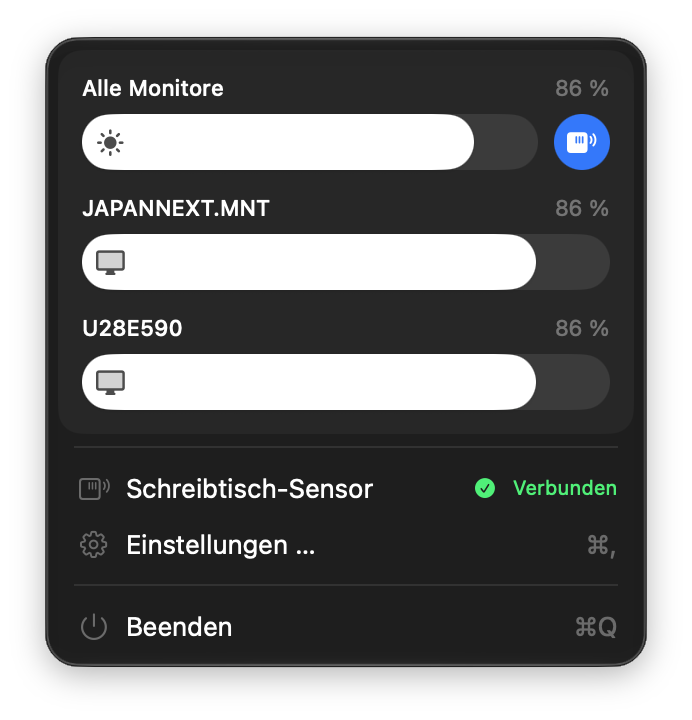
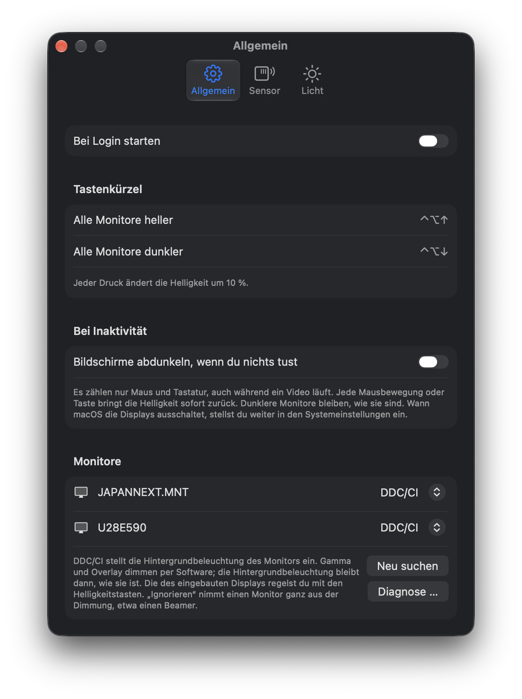
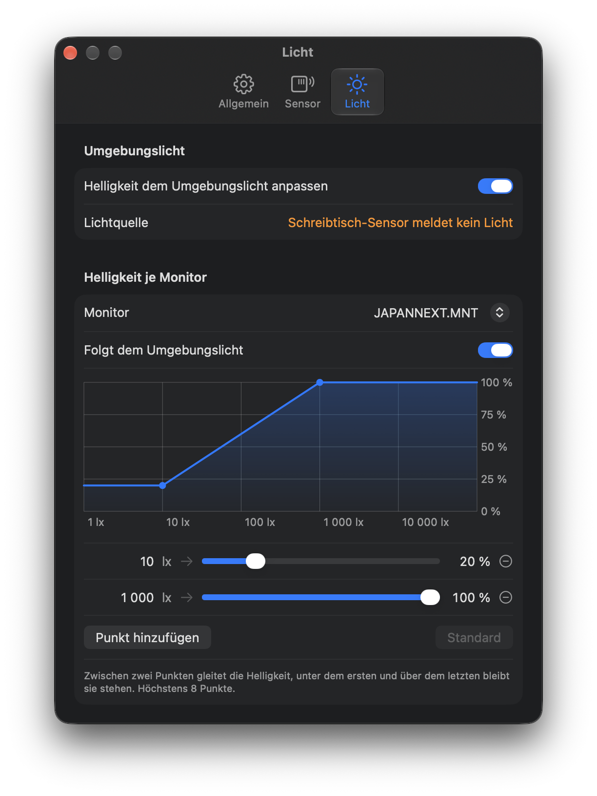
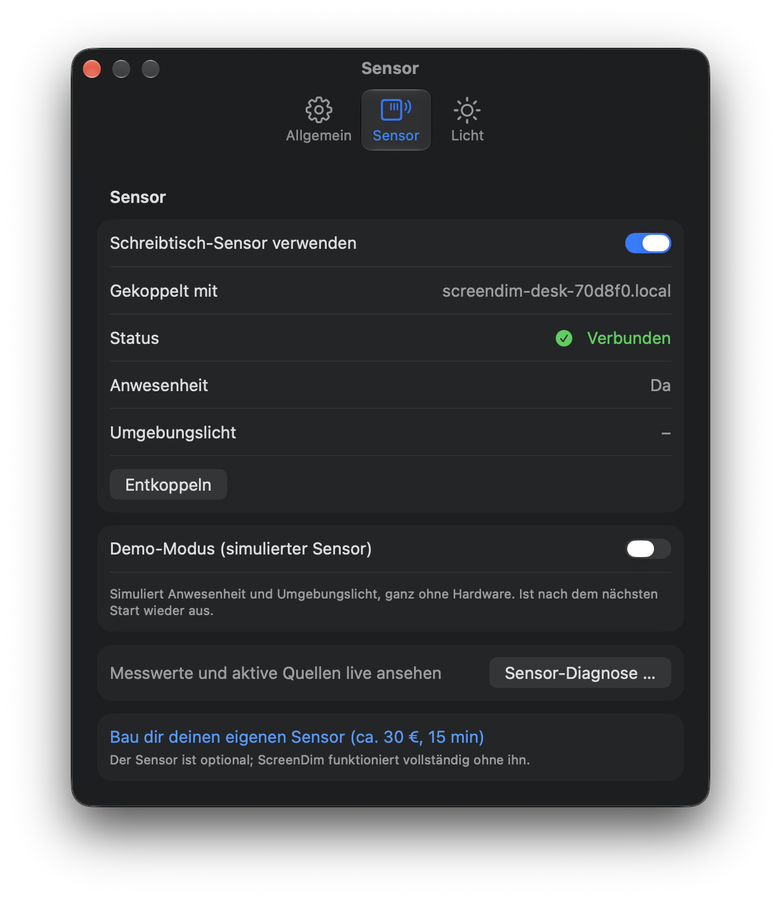

# ScreenDim

Helligkeit aller Displays aus der Menüleiste regeln: ein Slider pro Monitor, einer für
alle, dazu ⌃⌥↑ / ⌃⌥↓ für alle Monitore in 10-%-Schritten.

Externe Monitore regelt ScreenDim per DDC/CI, also an der Hintergrundbeleuchtung des
Monitors selbst. Wo DDC/CI nicht durchkommt (manche Docks und Adapter, DDC/CI im
Monitor-Menü aus), dimmt die Software: Gamma-Kurve oder halbtransparentes Overlay. Das
Verfahren ist pro Monitor wählbar. Das eingebaute Display lässt sich per Software dimmen;
seine Hintergrundbeleuchtung regelst du wie gewohnt mit den Helligkeitstasten. Optional
regelt ein Schreibtisch-Sensor (ESP32) die Helligkeit nach dem Umgebungslicht und
schaltet die Bildschirme bei Abwesenheit ab. Den Sensor baust du selbst aus einem
ESP32-S3-DevKitC-1, einem Waveshare HMMD mmWave Sensor (Anwesenheit) und einem
VEML7700-Modul (Licht), neun Leitungen; Stückliste, Schaltplan und Firmware stehen in
[`Firmware/`](Firmware/README.md).

Auf Wunsch dunkelt ScreenDim alle Monitore ab, wenn du eine Weile weder Maus noch Tastatur
benutzt (Zeit und Helligkeit wählbar, z. B. nach 15 min auf 5 %). Jede Eingabe bringt die
Helligkeit sofort zurück.

## So sieht es aus

<p align="center">
  
</p>

<table>
  <tr>
    <th>Allgemein</th>
    <th>Licht</th>
    <th>Sensor</th>
  </tr>
  <tr>
    <td valign="top"></td>
    <td valign="top"></td>
    <td valign="top"></td>
  </tr>
</table>

ScreenDim ist Open Source und wird außerhalb des Mac App Store verteilt (Developer ID,
notarisiert): DDC/CI auf Apple Silicon braucht `IOAVService`, eine private API, die Apple
im App Store nicht zulässt. Die App läuft deshalb ohne Sandbox.

## Voraussetzungen

macOS 15 oder neuer, Apple Silicon. Zum Bauen: Xcode, [XcodeGen](https://github.com/yonaskolb/XcodeGen).

## Bauen

```bash
xcodegen generate
```

```bash
xcodebuild -project ScreenDim.xcodeproj -scheme "ScreenDim" -destination 'generic/platform=macOS' -derivedDataPath /tmp/screendim-dd CODE_SIGNING_ALLOWED=NO build
```

## Tests

```bash
cd ScreenDimKit && swift test --scratch-path /tmp/screendim-kit-build
```

Die Tests brauchen weder die App noch Hardware.

## Aufbau

- `ScreenDimKit/`: Swift-Paket mit der Logik (DDC/CI-Protokoll, Display-Verwaltung,
  Software-Dimmung, Sensor, Speicher), ohne private API.
- `ScreenDim/`: die App (SwiftUI-Menü, Einstellungen, Diagnose, Tastenkürzel, Login-Item,
  I2C-Transport über `IOAVService`).
- `project.yml`: Projektbeschreibung für XcodeGen.
- `Firmware/`: ESPHome-Firmware des Schreibtisch-Sensors mit Stückliste und Schaltplan
  (`schaltplan.svg`).

Weitere Details stehen in `CLAUDE.md`. Offene Punkte stehen in `STATUS.md`, Änderungen in `CHANGELOG.md`.
